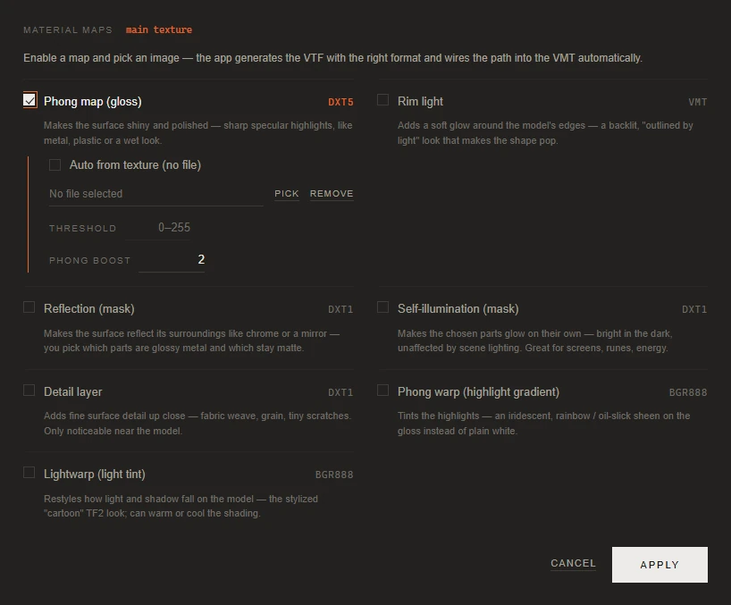
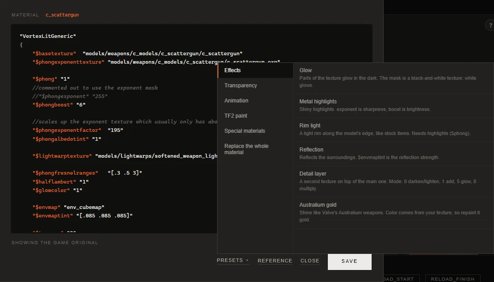

# Materials and effects

[Documentation](../README.md) · [Русская версия](../ru/materials.md)

A texture sets the colors of a model. How those colors react to light is decided by the material, the VMT file next to the texture. Gloss, glow in the dark, chrome reflections, transparency and animated textures all live there. The app gives you three ways to work with materials, from the simplest to the most flexible:

1. **Material maps**: pick an effect and an image, and the app generates the extra texture and wires it into the VMT.
2. **Normal Map** in the build options: surface relief built from your texture's brightness.
3. **The VMT editor**: the material as text, with ready blocks for common effects and a reference of parameters.

All three are available for items with a model: weapons, cosmetics, class bodies and hands, projectiles, pickups and taunt props. Material maps and the normal map also work for a mod from a VPK. They apply to the material whose card is selected in the album.

## Material maps

**Material maps** under the album opens a two-column window. On the left are all the maps a material can have: the checkbox turns a map on, and the line under its name shows where it comes from (a file, "Auto", "Builder", "From the mod" or "off"). On the right are the settings of the selected map: its description, the **Source** switch and its parameters. Pick an image with the button or just drop it on the field. Any change turns the map on by itself. The name of the current material is shown next to the window's title.

After **Apply** the app converts the image to a VTF in the format that map needs (shown on the right of its title) and adds the right lines to the VMT during the build. You don't need to know the paths or the parameter names.

| Map | What it gives | Auto from texture |
|---|---|---|
| **Phong map (gloss)** | Sharp specular highlights, like on metal, plastic or something wet. **Phong boost** sets how bright they are. | yes |
| **Highlight: colour and edges** | Tints the highlight with the colour of the texture itself, like metal in TF2 (gold shines gold), or with one colour of your own, and decides where the highlight is brighter: in the centre or at the edge. | no image needed |
| **Rim light** | A soft glow along the edges of the model, as if lit from behind. **Where it glows**: everywhere, by texture brightness or by your own mask. | optional mask |
| **Reflection (mask)** | Chrome-like reflections of the surroundings. The mask decides which areas are glossy metal and which stay matte. | yes |
| **Self-illumination (mask)** | Chosen areas glow on their own and stay bright in the dark. Good for screens, runes, energy. | yes |
| **Detail layer** | Fine detail visible up close: fabric weave, grain, small scratches. **Scale** sets how many times the detail repeats, **Blend** how it mixes with the base, **Factor** how strong it is. On cosmetics this slot holds the burning effect: with your map the item stops showing fire on itself. | no |
| **Phong warp (highlight gradient)** | Tints the highlights, for example into an oil-slick rainbow instead of plain white. | no, but has a builder |
| **Lightwarp (light tint)** | Changes how light and shadow fall on the model, the stylized look TF2 is known for. Can make the shading warmer or colder. | no, but has a builder |

**Auto from texture (no file)** builds the map from the brightness of the base texture, so you don't have to draw a mask: lighter areas shine or glow more. Leave **Threshold** empty for a smooth mask, or enter a value from 0 to 255 to make it sharp: then only pixels at least that bright are affected. For the gloss map, auto mode also adds world reflections, which gives a shiny metal look in one click.

The game reads where an item is glossy from the alpha channel of the normal map, not from the Phong map itself. So the app puts the gloss mask and the reflection mask there. If the item has its own normal map (TF2 weapons almost always do), its relief is kept and only the alpha changes. On items with gloss, one mask decides both where highlights and where reflections are: that is how the engine works.

**Blend** for the Detail layer:

| Mode | What it does |
|---|---|
| **Modulate** | Darker than the middle (128) darkens the base, lighter brightens it. This is how Valve uses detail. |
| **Additive** | Only brightens. |
| **Colour layer by alpha** | Coloured detail on top of the base where the detail has alpha. |
| **Glow** | The detail glows on its own, unlit. On items with a normal map it works only together with gloss. |

Multiply and the other modes that do not render at all on models with a normal map are not in the list.

To remove a map, untick it and press **Apply**. **Cancel** closes the window without changes. Each material keeps its own set of maps, and they are part of the item's work.

### Phong map, highlight colour and rim mask

The game reads the Phong map per channel: red sets the highlight size (black wide, white pinpoint), green decides how much the highlight is tinted by the texture colour, alpha is where the rim light glows. The app builds these channels itself:

* your own **Phong map** sets the highlight size. The material's `$phongexponent` is removed for that: if it is present (TF2 weapons almost always have it), the game takes the size from it and ignores the map;
* **Highlight colour → From texture** writes the tint strength into the green channel. **Own colour** tints the highlight with one colour. The two do not work together: an own colour turns texture tinting off;
* **Rim light → Where it glows** set to Auto or Mask puts the mask into alpha. If the material already has a Phong map (from the mod or the game), its highlight size is kept and only the needed channels change.

### Reflection, glow and highlight settings

An empty field or an untouched slider (shown dimmed) means "as the item has": nothing is written into the material.

**Reflection (mask)**

| Setting | What it does |
|---|---|
| **Environment** | What gets reflected: **Original**, **Map** (the current map environment), **Studio** (even studio light, like many TF2 items), **Gold** (like Australium), **Saxxy** (the statuette gold), **Sunset**. |
| **Colour** and **Strength** | Reflection colour and brightness. Make chrome golden or coppery. |
| **Stronger at the edge** | The reflection is weaker where the surface faces you and stronger on bends, like lacquer. This turns on gloss at strength 0, so no highlight appears. |

**Self-illumination (mask)**

| Setting | What it does |
|---|---|
| **Colour** and **Brightness** | Paint the mask white and pick the colour here. Brightness above 100 glows stronger than usual. |
| **Pulse** | The glow gently blinks: brighter, then dimmer. Slow, medium or fast: how often. **Dimmest** sets how far it fades. |
| **Fade to edge** | The glow is brighter where the surface faces you and weaker towards the model edges. **Brightness** sets the glow strength in the centre, **Narrow to centre** sets the size of the glowing spot. In this mode the mask is taken from the alpha channel of the base texture. |

**Highlight: colour and edges** - besides the colour, three fields **Highlight centre**, **middle** and **edge** set where the highlight is brighter. Above 1 at the edge makes the edge shine more than the centre, like lacquer. The sphere next to them shows the result.

**Previews in the other cards.** They follow the game's shader formulas with one light and an even environment:

- **Phong map** - your texture bent like a barrel under a moving light, and **Highlight only** next to it. A narrow highlight is sharp, a wide one is soft.
- **Rim light** - a sphere with the light circling it: the rim shows when the light is behind. With a mask, the mask is shown next to it.
- **Reflection** - a sphere with the real cubemap from the game files and your texture with the reflection by the mask. The map environment differs on every map, so **Map** shows a studio example.
- **Detail** - your texture with the detail: scale, mode and strength as in the game.

The light and model shape in the game differ, so the preview shows what a field changes, not an exact in-game frame.

### Phong warp builder

Phong warp is a 256×256 image the game multiplies the highlight by. Horizontally it is highlight strength (the centre on the right), vertically the viewing angle (the model edge at the bottom). White keeps the highlight as it was, a colour tints it. It cannot get brighter: the Phong map **Phong boost** sets that.

The **Builder** source has patterns: **Rainbow sheen**, **Oil slick**, **Gold** and **Own gradient** from colour stops (from the highlight edge to its centre). **Strength** mixes the pattern with white, **Bands** and **Hue shift** are for rainbow and oil, **Edge colour** tints the highlight along the model outline.

**Own gradient** and **Gold** have a **Direction**: which way the stop colours run across the square. Set it with the 0°, 45°, 90°, 135° buttons, a number, or just drag on the square, and the arrow on it shows the direction. **Different colours at the model edge** adds a second row of stops: the top of the square takes the first row colours, the bottom takes the second, with a smooth blend between. So the highlight is one colour in the middle of the item and another along its outline. Every field explains itself on hover. Next to them are the gradient itself and two spheres: **Plain highlight** and **With the gradient**. With a gradient the game turns off the `$phongfresnelranges` mask, so the highlight gets brighter in the middle of the sphere, and the sphere shows that.

### Lightwarp builder

In the game a lightwarp is a strip 256 pixels wide. Every point of the model checks how lit it is and takes its colour from the strip: the left end for shadow, the right end for direct light. Half brightness in the strip (128) means normal brightness, anything lighter overbrightens. Drawing such a strip by hand is awkward, so the map has the **Builder** source.

| Setting | What it does |
|---|---|
| **Base** | A ready strip from the game files. "Characters and items" is used by TF2 characters and most items, "hard two-tone" gives a cartoon step between light and shadow, "soft" a smooth transition, and "neutral" looks as if there were no lightwarp at all. |
| **Steps** | Splits the lighting into 2 to 8 flat bands: hard cartoon shadows (cel shading). "Smooth" keeps the base as it is. |
| **Brightness** | Overall brightness of the strip, from 50 to 150 percent. |
| **Shadow tint** | A colour and how strongly it tints the dark side. Shadow brightness stays the same, only the colour changes. |
| **Light tint** | The same for the lit side. |

**Your own base: colour stops.** Pick "Own gradient" in **Base**. A bar with stops under it appears above the settings. Clicking the bar adds a stop, a stop can be dragged with the mouse or moved with the arrow keys, and <kbd>Delete</kbd> removes it. The colour and position of the selected stop are edited with the fields under the bar. Two stops at one place give a hard edge, a cartoon shadow without steps. A stop's colour goes into the file as it is.

**Turn into stops** converts any base together with all settings into stops. For example, take the TF2 character strip, turn it into stops and adjust one transition.

Under the strip there is a brightness graph per channel. The dashed line is normal brightness (128), and anything above it overbrightens in the game.

Under the base there are two spheres: **Without lightwarp** and **With the strip**. They are lit with the game formula: direct light goes through the strip, ambient light bypasses it (that is how the shader works), and without a strip the shading falls off the same way it does in the game. Next to them are the strip itself and the graph. The spheres have no highlights, reflections or the real light of a map, so in the game it looks close but not identical. The strip goes into the mod as uncompressed BGR888 without mipmaps and clamped at the edges, as Valve recommends.

### Maps from a mod

When a mod from a VPK is open, the window finds the maps its material already has. Such maps are ticked, marked **From the mod** and show their texture. Their numbers (phong boost, detail scale and so on) come from the mod's material.

* Keep the tick and the map goes into the mod as it was. Changed numbers are written into the material.
* Pick your own file or turn on auto mode, and your map replaces the mod's.
* Untick it, and the build removes the map from the material, and its texture from the archive if nothing else uses it.

Until you press **Apply** in the maps window for a material, the mod's material is built unchanged.

## Normal map

A normal map tells the game how light should fall on the surface, so flat paint gets depth: seams, rivets, scratches, fabric. The app builds one from the brightness of your texture: light areas come out raised, dark areas recessed.

Open **Parameters** and tick **Normal Map** in the **Options** column. The relief appears on the model right away, and the preview is built the same way as the texture that will go into the mod.

| Setting | What it does |
|---|---|
| **Relief strength** | How deep the relief is, from 0 to 300 percent. 100 is a moderate relief that suits most weapons. |
| **Invert** | Light becomes recessed and dark becomes raised. |
| **Replace the original relief** | Appears when the item already has a normal map in the game. By default your relief is laid on top of the game's one, and the game's alpha channel, which often holds the gloss mask, is kept. Tick this to drop the game's relief and use only yours. |

The normal map follows the per-texture settings, so different materials can have different strength. If the texture is a GIF, the relief is animated together with it.

Without your own image the relief is built from the game texture, so you can add depth to a stock look as well.

## The VMT editor

**VMT** under the album opens the material of the current card as text. If you saved an edit before, you see it; otherwise you see the original from the game.

The editor highlights the syntax, and hovering a `$parameter` shows what it does. <kbd>Ctrl</kbd>+<kbd>S</kbd> saves, <kbd>Esc</kbd> closes. The status line tells you whether there are unsaved changes and whether a custom VMT is in use.

| Button | What it does |
|---|---|
| **Presets ▾** | Ready blocks for common effects, grouped by purpose. See below. |
| **Reference** | A searchable list of material parameters by group. A click inserts the parameter at the cursor; if it's already in the material, the cursor jumps to it. |
| **As in the game** | Deletes your edit. The material goes back to the game's original. |
| **Close** | Closes the editor. |
| **Save** | Saves the edit. A VMT with broken syntax (an unclosed brace or quote, no shader name) isn't saved: in game such a material turns invisible, and the reason would be hard to find. |

### Presets

The presets are merged into the material you already have instead of replacing it. Values replace parameters with the same name, and proxies are added to the end of the existing `Proxies` block. The game reads only the first such block, and the order of proxies matters, so they always go there.

| Group | Presets |
|---|---|
| **Effects** | **Glow** (a black-and-white mask, white parts glow), **Metal highlights**, **Rim light**, **Reflection**, **Detail layer**, **Australium gold** (the shine of Valve's Australium weapons; repaint your texture gold to match) |
| **Transparency** | **Smooth transparency** (from the alpha channel), **Cut out by alpha** (hard edges, for grates and foliage), **Glow over background** (black is invisible, bright parts glow), **Visible from both sides** |
| **Animation** | **Frame animation** (plays the frames of a multi-frame texture), **Scrolling texture** (conveyors, energy streams) |
| **TF2 paint** | **In-game paint**: the item takes paint from the inventory where the texture's alpha is white |
| **Special materials** | **Ghost shell**: the weapon becomes a translucent glowing shell, with a choice of color and reflection. **Glass**: the middle or the whole weapon turns into glass that bends the world behind it, like the Spy's cloak, and keeps its texture. **Killstreak sheen color** and **Crit glow color**: see below. **Wireframe**: the model is drawn as a mesh of edges; the flag is rare, so check it in game. |
| **Replace the whole material** | **VertexLitGeneric (basic)**, **UnlitGeneric (unlit)**, **Chrome / mirror**. These replace the whole VMT, so the editor asks first. |

Presets with settings (**Ghost shell**, **Glass**, **Killstreak sheen color**, **Crit glow color**) open a small form instead of inserting text right away. If the effect is already in the material, the form starts from its current values.

**Killstreak sheen color.** Every frame the game sets the sheen color from the Killstreak kit, and the effect sets its own right after it, so yours wins. **Pattern** changes the sheen itself: the ready ones (one or two stripes, running stripes, flash, sparkles, comet with sparkles, mist) are the templates of the pattern builder, and **+ Own pattern** opens the builder itself. The game pattern and the ready ones take one color or a rainbow and a **Sweep length**, how many seconds it lasts. Your own pattern is colored by its layers, so the form has no color or length for it: they are set in the builder. **Brightness** is always there. **Look** for a ready pattern: **Glows** (the usual sheen) or **Black, darkens**, where the stripe runs over the weapon as a shadow; black has no color choice, and **Brightness** sets how dark it is. Black does not work with the **As in game** pattern; in your own pattern black is set by the layer colors. **Shine** for a custom pattern: **Even** shows the whole pattern, **Live** uses the game reflection, where the pattern shows only in its bright spots. The pattern belongs to this material only (GameBanana mods change the sheen on every weapon at once), and the build adds the pattern file to the mod. With a killstreak the pause between sweeps still shrinks with each kill, as in the game. **Always, on any weapon** runs the sheen even without a killstreak, with a pause between sweeps; the stripe is placed from the model size the same way the game does it. On your own model the stock model size is used, so the stripe may sit a little differently.

**Your own sheen pattern.** The **+ Own pattern** button in the **Pattern** field opens the builder. A pattern is made of layers: stripe, flash, sparkles, mist, picture. Each layer has its own settings (direction, width, tilt, waviness, how many stripes or sparkles) and its own time span inside the sweep: drag it on the timeline at the bottom, by the middle or by the edges. **Start from** gives ready patterns to begin with.

On the left is the preview: a tile with the proportions of the selected weapon. The sheen lands on the side of the weapon flat, like a stencil, so the tile shows the pattern as the game does. **Killstreak** changes the pause between sweeps as in the game: 5 s with no kills, 1 s less per kill. The **Picture** layer reveals your picture with the sheen: light, opaque parts glow, black and transparent parts do not. The arrow sets the direction of movement: drag it with the mouse, 15° steps, any angle with Alt. A selected picture gets a frame on the tile: drag the middle to move it, a corner to resize, the dot above the frame to rotate (15° steps with Shift); the mouse wheel resizes too. The frames are recalculated when you release the mouse.

Each layer has its own **Color**, and with **Gradient** ticked a gradient of color points, pointed by the arrow across the weapon or **Over time** (the layer changes color during the sweep). The layer color is written into the mask itself. In the game all visible layers of one pattern share the same amount of red, so colors split into two ranges: light (white, yellow, orange, red, pink) and dark (black, blue, cyan, green). The app picks the range from the layer colors, and when the ranges are mixed the line under the preview names the layers the game will not show. The preview blends the layers the way the game does: black darkens the weapon.

A saved pattern appears in the **Pattern** field next to the ready ones, and **Edit pattern** opens it again. Patterns are stored next to your works, and editing a pattern reaches every weapon that uses it on the next build.

**Crit glow color.** Under crits a weapon glows red on RED and blue on BLU. The effect swaps these colors for yours, separately per team. The Demoman shield charge fades into your color smoothly. Buff glows (Soldier banners, Crit-a-Cola) keep their own color.

Only you see both effects: they change the material in your game. Your color also shows on other players' weapons of the same model. In casual, as with any material mod, you need the sv_pure bypass.

### Good to know

- **An edit belongs to the material name, not to one work.** Every item that uses the same material picks the edit up when you build it, until you press **As in the game**. **Discard edits** under the album doesn't touch VMT edits.
- **Your edit survives builds.** You can build several times without opening the editor again.
- **Changing `$basetexture` is respected.** If you point the material at another texture in the editor, the build keeps that path and doesn't replace it with your image.
- **On weapons and cosmetics a static `$color2` doesn't hold.** A proxy in the game's materials overwrites it every frame, and `$color` has no effect on models at all. To tint an item, use the **In-game paint** preset or paint the texture itself.
- The editor isn't available for sprays, the crit text, death effects, skyboxes and opened VPK mods. For these the app either writes the material itself or keeps the game's one on purpose: death effects, for example, rely on special game shaders that a custom VMT would break.

## Materials that take color from the VMT

Many weapons and about two thirds of cosmetics are painted by the material: wherever the texture's alpha channel is white, the game applies a color stored in the VMT. If your image has no alpha, the build warns you before the whole item turns one color in game and offers several ways out. The question and its answers are described in [Your first skin](reskin.md#7-build), and the cosmetics side of it in [Cosmetics](cosmetics.md#team-colors-and-game-paints).

## Service and hidden materials

Some materials are hidden from the album on purpose: eyes, teeth, tongues, über (invulnerability) overlays, zombie skins, sheen and fresnel overlays. They go into the mod with their game textures. **Other** under the album shows them as cards when you do want to replace one. While it's on, the model wears the card you stop at in the place that card takes in its skin: the über body on the body, the zombie head on the head.

An über or zombie variant of a class body has no image of yours unless you give it one, and the build asks about it. **Copy the main one** then takes the texture of the part the variant replaces: the body for the body, the head for the head, the BLU body for the BLU variant. If that part kept its game texture, or it's the eyes, the variant keeps its own game texture too: there is nothing of yours to copy.

You can hide more materials yourself in **Settings → Hidden materials**. See [Settings](settings.md#hidden-materials).

## See also

- [Your first skin](reskin.md): the basics of textures and building.
- [Painting by parts](model-parts.md): different colors on different pieces of one material, and [a material of its own](model-parts.md#own-material-for-a-part) for a piece that needs its own VMT.
- [Settings](settings.md): advanced VTF flags and hidden materials.
