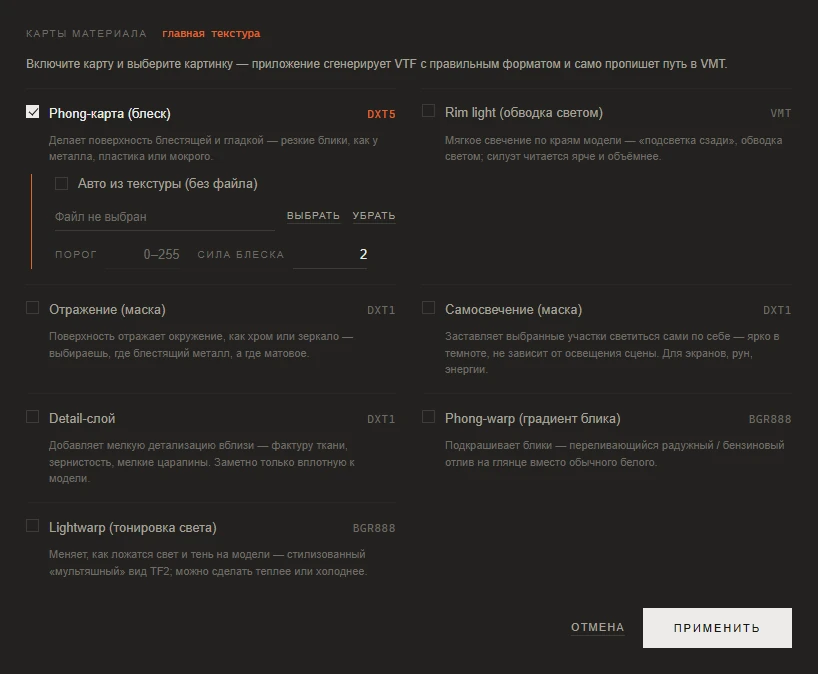
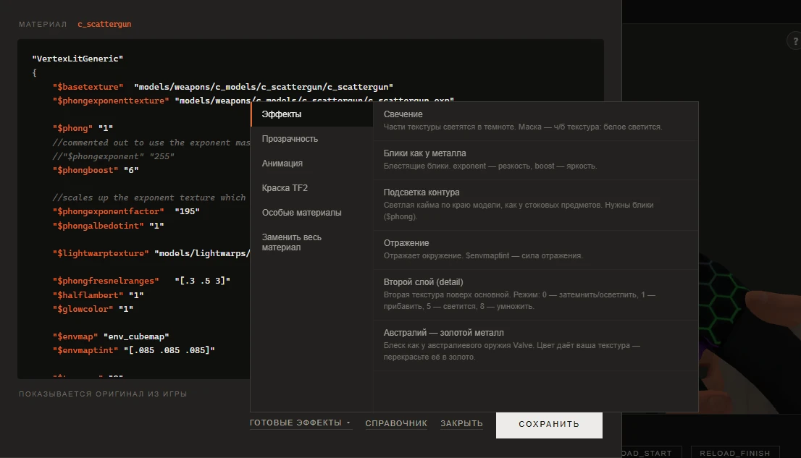

# Материалы и эффекты

[Документация](../README.md) · [English version](../en/materials.md)

Текстура задаёт цвета модели, а то, как эти цвета ведут себя на свету, решает материал: файл VMT рядом с текстурой. Блеск, свечение в темноте, хромированные отражения, прозрачность и анимированные текстуры живут именно там. Работать с материалами в приложении можно тремя способами, от самого простого к самому гибкому:

1. **Карты материала**: выбираете эффект и картинку, а приложение само делает дополнительную текстуру и прописывает её в VMT.
2. **Normal Map** в опциях сборки: рельеф поверхности, построенный по яркости вашей текстуры.
3. **Редактор VMT**: материал в виде текста, с готовыми блоками для частых эффектов и справочником параметров.

Все три доступны у предметов с моделью: оружия, косметики, тел и рук классов, снарядов, аптечек и реквизита насмешек. Карты материала и Normal Map работают и у мода из VPK. Они относятся к материалу той карточки, которая выбрана в альбоме.

## Карты материала

Кнопка **Карты материала** под альбомом открывает окно в две колонки. Слева все карты, которые может получить материал: галка включает карту, а строка под названием показывает, откуда она берётся (файл, «Авто», «Конструктор», «Из мода» или «выключена»). Справа настройки выбранной карты: описание, переключатель **Источник** и её параметры. Картинку можно выбрать кнопкой или просто перетащить на поле. Любая правка сама включает карту. Имя текущего материала написано рядом с заголовком окна.

После **Применить** приложение переведёт картинку в VTF нужного этой карте формата (он указан справа от её названия) и при сборке допишет в VMT нужные строки. Знать пути и имена параметров не нужно.

| Карта | Что даёт | Авто из текстуры |
|---|---|---|
| **Phong-карта (блеск)** | Резкие блики, как у металла, пластика или мокрой поверхности. **Сила блеска** задаёт их яркость. | да |
| **Блик: цвет и края** | Красит блик цветом самой текстуры, как у металла в TF2 (золото блестит золотом), или одним своим цветом, и решает, где блик ярче: в центре или по краю. | картинка не нужна |
| **Rim light (обводка светом)** | Мягкое свечение по краям модели, будто её подсветили сзади. **Где светится**: везде, по яркости текстуры или по своей маске. | маска по желанию |
| **Отражение (маска)** | Отражения окружения, как у хрома. Маска решает, где блестящий металл, а где матовая поверхность. | да |
| **Самосвечение (маска)** | Выбранные участки светятся сами и остаются яркими в темноте. Подходит для экранов, рун, энергии. | да |
| **Detail-слой** | Мелкая детализация, заметная вблизи: фактура ткани, зерно, мелкие царапины. **Масштаб** задаёт, сколько раз деталь повторяется, **Смешивание** задаёт способ наложения на основу, **Сила** определяет, насколько деталь заметна. У косметики этот слот занят огнём при горении: с вашей картой предмет перестанет показывать огонь на себе. | нет |
| **Phong-warp (градиент блика)** | Подкрашивает блики, например в радужный бензиновый отлив вместо обычного белого. | нет, но есть конструктор |
| **Lightwarp (тонировка света)** | Меняет то, как ложатся свет и тень на модели: тот самый стилизованный вид TF2. Можно сделать затенение теплее или холоднее. | нет, но есть конструктор |

**Авто из текстуры (без файла)** строит карту по яркости базовой текстуры, так что маску рисовать не нужно: чем светлее участок, тем сильнее он блестит или светится. Оставьте **Порог** пустым, чтобы маска была плавной, или впишите число от 0 до 255, чтобы сделать её резкой: тогда эффект получат только пиксели не темнее этого значения. Для карты блеска авто-режим ещё и добавляет отражение мира, и получается «блестящий металл» в один щелчок.

Где именно блестит предмет, игра читает из альфа-канала карты нормалей, а не из самой Phong-карты. Поэтому маску блеска и маску отражения приложение кладёт туда. Если у предмета есть своя карта нормалей (у оружия TF2 она почти всегда есть), её рельеф сохраняется, меняется только альфа. У предметов с блеском одна и та же маска решает и где блик, и где отражение: так устроен движок.

**Смешивание** у Detail-слоя:

| Режим | Что делает |
|---|---|
| **Модуляция** | Тёмнее середины (128) затемняет основу, светлее высветляет. Так Valve использует detail у себя. |
| **Сложение** | Только высветляет. |
| **Цветной слой по альфе** | Цветная деталь поверх основы там, где у неё есть альфа. |
| **Свечение** | Деталь светится сама, без освещения. На предметах с картой нормалей работает только вместе с блеском. |

Режимов «Умножение» и других, которые на моделях с картой нормалей не рисуются вовсе, в списке нет.

Чтобы убрать карту, снимите её галку и нажмите **Применить**. **Отмена** закрывает окно без изменений. У каждого материала свой набор карт, и они входят в работу над предметом.

### Phong-карта, цвет блика и маска обводки

Phong-карта у игры поканальная: красный канал задаёт размер блика (чёрное широкий, белое точечный), зелёный решает, насколько блик окрашен цветом текстуры, альфа - где светится обводка. Приложение собирает эти каналы само:

* своя **Phong-карта** задаёт размер блика. Параметр `$phongexponent` материала при этом снимается: если он есть (у оружия TF2 почти всегда), игра берёт размер блика из него, а карту не читает;
* **Цвет блика → От текстуры** пишет силу окраски в зелёный канал. **Свой цвет** красит блик одним цветом. Оба режима сразу не работают: свой цвет отключает окраску текстурой;
* **Rim light → Где светится** с режимом «Авто» или «Маска» кладёт маску в альфу. Если у материала уже есть Phong-карта (из мода или игры), её размер блика сохраняется, меняются только нужные каналы.

### Настройки отражения, свечения и блика

Пустое поле или не тронутый ползунок (он показан бледным) значит «как у предмета»: в материал ничего не пишется.

**Отражение (маска)**

| Настройка | Что делает |
|---|---|
| **Окружение** | Что отражается: **Как было**, **Карта** (окружение текущей карты), **Студия** (ровный студийный свет, как у многих предметов TF2), **Золото** (как у австралия), **Saxxy** (золото статуэтки), **Закат**. |
| **Цвет** и **Сила** | Цвет отражения и его яркость. Хром можно сделать золотистым или медным. |
| **Сильнее по краю** | Отражение слабее там, где поверхность смотрит на вас, и сильнее на изгибах, как у лака. Для этого включается блеск с силой 0, сам блик не появится. |

**Самосвечение (маска)**

| Настройка | Что делает |
|---|---|
| **Цвет** и **Яркость** | Маску рисуйте белой, цвет выбирайте здесь. Яркость больше 100 светит сильнее обычного. |
| **Пульсация** | Свечение плавно мигает: то ярче, то тусклее. Медленно, средне или быстро: как часто. **Тусклее всего** задаёт, до какой яркости оно гаснет. |
| **Затухание к краю** | Свечение ярче на поверхности, повёрнутой к вам, и слабее к краям модели. **Яркость** задаёт силу свечения в центре, **Сужение к центру** задаёт размер светящегося пятна. В этом режиме маска берётся из альфа-канала основной текстуры. |

**Блик: цвет и края** - кроме цвета, три поля **Блик в центре**, **посередине** и **по краю** задают, где блик ярче. Больше 1 у края - край блестит сильнее центра, как лак. Шар рядом показывает результат.

**Превью в остальных карточках.** Они считаются по формулам шейдера игры, свет один, окружение ровное:

- **Phong-карта** - ваша текстура, согнутая как ствол, под движущимся светом, и рядом **Только блик**. Узкий блик - острый, широкий - мягкий.
- **Rim light** - шар, вокруг которого ходит свет: обводка видна, когда свет сзади. При маске рядом видна сама маска.
- **Отражение** - шар с настоящей кубмапой из файлов игры и ваша текстура с отражением по маске. Окружение карты на каждой карте своё, поэтому для **Карта** показан студийный пример.
- **Detail** - ваша текстура с деталью: масштаб, режим и сила как в игре.

Свет и форма модели в игре другие, поэтому превью показывает, что меняет поле, а не точный кадр из игры.

### Конструктор Phong-warp

Phong-warp - картинка 256×256, на которую игра умножает блик. По горизонтали сила блика (справа центр), по вертикали угол взгляда (внизу край модели). Белый оставляет блик как был, цвет красит его. Ярче блик не станет, силу задаёт **Сила блеска** Phong-карты.

У источника **Конструктор** есть узоры: **Радужный отлив**, **Бензиновая плёнка**, **Золото** и **Свой градиент** из цветных точек (от края блика к центру). **Сила** смешивает узор с белым, **Полосы** и **Сдвиг оттенка** есть у радуги и плёнки, **Цвет у края** подкрашивает блик по контуру модели.

У **Своего градиента** и **Золота** есть **Направление**: куда идут цвета точек по квадрату. Его задают кнопками 0°, 45°, 90°, 135°, числом или просто тянут мышью по квадрату, и стрелка на нём показывает направление. Галка **Другие цвета у края модели** добавляет второй ряд точек: верх квадрата берёт цвета первого ряда, низ - второго, между ними плавный переход. Так блик в середине предмета одного цвета, а по контуру другого. Подсказка при наведении есть у каждого поля. Рядом сам градиент и два шара: **Обычный блик** и **С градиентом**. С градиентом игра отключает маску `$phongfresnelranges`, поэтому блик у центра шара становится ярче, и шар это показывает.

### Конструктор Lightwarp

Lightwarp в игре это полоска шириной 256 пикселей. Каждая точка модели смотрит, насколько она освещена, и берёт цвет из полоски: левый край для тени, правый для прямого света. Середина яркости полоски (128) означает обычную яркость, светлее даёт пересвет. Рисовать такую полоску руками неудобно, поэтому у карты есть источник **Конструктор**.

| Настройка | Что делает |
|---|---|
| **Основа** | Готовая полоска из файлов игры. «Персонажи и вещи» стоит у персонажей и большинства предметов TF2, «резкая двухтоновая» даёт мультяшную ступень света и тени, «мягкая» плавный переход, «нейтральная» выглядит так, будто lightwarp нет вовсе. |
| **Ступени** | Делит освещение на 2-8 ровных полос: резкие мультяшные тени (cel shading). «Плавно» оставляет основу как есть. |
| **Яркость** | Общая яркость полоски, от 50 до 150 процентов. |
| **Оттенок теней** | Цвет и сила, с которой он окрашивает тёмную сторону. Яркость тени при этом не меняется, меняется только цвет. |
| **Оттенок света** | То же для освещённой стороны. |

**Своя основа: цветные точки.** В списке **Основа** выберите «Свой градиент». Над настройками появится полоса с точками под ней. Щелчок по полосе добавляет точку, точку можно перетащить мышью или сдвинуть стрелками, <kbd>Delete</kbd> её убирает. Цвет и позиция выбранной точки правятся полями под полосой. Две точки в одном месте дают резкую границу, то есть мультяшную тень без ступеней. Цвет точки попадает в файл как есть.

Кнопка **Сделать точками** превращает любую основу вместе со всеми настройками в точки. Например, можно взять полоску персонажей TF2, превратить её в точки и поправить один переход.

Под полосой виден график яркости по каналам. Пунктир на нём - обычная яркость (128), всё выше пунктира в игре даёт пересвет.

Под основой видны два шара: **Без lightwarp** и **С полоской**. Они освещены по формуле игры: прямой свет проходит через полоску, окружающий свет её минует (так устроен шейдер), а без полоски полутень считается так же, как в игре без неё. Рядом сама полоска и график. Бликов, отражений и настоящего света карты на шарах нет, поэтому в игре картинка будет близкой, но не один в один. Полоска уходит в мод в формате BGR888 без сжатия и мипмапов, с запретом повтора по краям, как советует Valve.

### Карты из мода

Если открыт мод из VPK, окно само находит карты, которые уже прописаны в его материале. Такие карты отмечены галкой, помечены **Из мода** и показывают свою текстуру. Их числа (сила блеска, масштаб detail и другие) взяты из материала мода.

* Оставьте галку, и карта уйдёт в мод как была. Изменённые числа впишутся в материал.
* Выберите свой файл или включите авто-режим, и карта мода заменится вашей.
* Снимите галку, и при сборке карта исчезнет из материала, а её текстура, если на неё больше никто не ссылается, из архива.

Пока окно карт у материала не открывали и не нажимали **Применить**, материал мода собирается без изменений.

## Карта нормалей

Карта нормалей подсказывает игре, как свет должен ложиться на поверхность, и плоский рисунок получает объём: швы, заклёпки, царапины, ткань. Приложение строит её по яркости вашей текстуры: светлые места выходят выпуклыми, тёмные вдавленными.

Откройте **Параметры** и отметьте **Normal Map** в колонке **Опции**. Рельеф сразу появится на модели, причём превью строится так же, как текстура, которая уйдёт в мод.

| Настройка | Что делает |
|---|---|
| **Сила рельефа** | Насколько глубоким выйдет рельеф, от 0 до 300 процентов. 100 даёт умеренный рельеф, который подходит большинству оружия. |
| **Инвертировать** | Светлое становится вдавленным, а тёмное выпуклым. |
| **Заменить родной рельеф** | Появляется, если у предмета в игре уже есть своя карта нормалей. По умолчанию ваш рельеф ложится поверх игрового, а альфа-канал игровой карты, в котором часто лежит маска блеска, сохраняется. Отметьте галку, чтобы убрать игровой рельеф и оставить только свой. |

Карта нормалей подчиняется своим настройкам текстуры, так что у разных материалов может быть разная сила рельефа. Если текстура анимированная (GIF), рельеф анимируется вместе с ней.

Если своей картинки нет, рельеф строится по игровой текстуре, так что объём можно добавить и стоковому виду.

## Редактор VMT

Кнопка **VMT** под альбомом открывает материал текущей карточки в виде текста. Если вы уже сохраняли правку, откроется она, иначе оригинал из игры.

Редактор подсвечивает синтаксис, а при наведении на `$параметр` показывает, что он делает. <kbd>Ctrl</kbd>+<kbd>S</kbd> сохраняет, <kbd>Esc</kbd> закрывает. Строка состояния подскажет, есть ли несохранённые изменения и используется ли свой VMT.

| Кнопка | Что делает |
|---|---|
| **Готовые эффекты ▾** | Готовые блоки для частых эффектов, сгруппированные по назначению. См. ниже. |
| **Справочник** | Список параметров материала по группам, с поиском. Щелчок вставляет параметр в позицию курсора, а если он уже есть в материале, курсор переходит к нему. |
| **Как в игре** | Удаляет вашу правку, и материал возвращается к игровому оригиналу. |
| **Закрыть** | Закрывает редактор. |
| **Сохранить** | Сохраняет правку. VMT со сломанным синтаксисом (незакрытая скобка или кавычка, нет имени шейдера) не сохранится: в игре такой материал становится невидимым, а причину потом трудно найти. |

### Готовые эффекты

Готовые эффекты вливаются в уже существующий материал, а не заменяют его. Значения перекрывают одноимённые параметры, а прокси добавляются в конец уже имеющегося блока `Proxies`. Игра читает только первый такой блок, и порядок прокси важен, поэтому они всегда попадают туда.

| Группа | Эффекты |
|---|---|
| **Эффекты** | **Свечение** (чёрно-белая маска, белые места светятся), **Блики как у металла**, **Подсветка контура**, **Отражение**, **Второй слой (detail)**, **Австралий - золотой металл** (блеск как у австралиевого оружия Valve; саму текстуру перекрасьте в золото) |
| **Прозрачность** | **Плавная прозрачность** (по альфа-каналу), **Вырезать по альфе** (резкие края, для решёток и листвы), **Светится поверх фона** (чёрное невидимо, светлое светится), **Видно с обеих сторон** |
| **Анимация** | **Покадровая анимация** (проигрывает кадры многокадровой текстуры), **Прокрутка текстуры** (конвейеры, потоки энергии) |
| **Краска TF2** | **Краска из игры**: предмет красится краской из инвентаря там, где альфа текстуры белая |
| **Особые материалы** | **Призрачная оболочка**: оружие становится полупрозрачной светящейся оболочкой, цвет и отражение выбираются. **Стекло**: середина или всё оружие становится стеклом, сквозь которое мир виден с искажением, как у плаща Шпиона, а текстура материала остаётся. **Цвет блеска киллстрика** и **Цвет свечения крита**: см. ниже. **Каркас**: модель рисуется сеткой рёбер; флаг редкий, проверьте его в игре. |
| **Заменить весь материал** | **VertexLitGeneric (базовый)**, **UnlitGeneric (без освещения)**, **Хром / зеркало**. Они заменяют VMT целиком, поэтому редактор сначала спросит. |

Эффекты с настройками (**Призрачная оболочка**, **Стекло**, **Цвет блеска киллстрика**, **Цвет свечения крита**) открывают небольшую форму вместо того, чтобы сразу вставить текст. Если эффект уже стоит в материале, форма начинается с его текущих значений.

**Цвет блеска киллстрика.** Игра каждый кадр ставит цвет блеска из набора Killstreak, а эффект ставит свой сразу после неё, так что выигрывает ваш. **Узор** меняет сам рисунок блеска: готовые (одна или две полосы, бегущие полосы, вспышка, искры, комета с искрами, дымка) - это шаблоны конструктора узоров, а **+ Свой узор** открывает сам конструктор. У игрового и готового узора можно один цвет или радугу и **Длину прохода** - сколько секунд он идёт. Свой узор красят его слои, поэтому цвета и длины в форме у него нет: они задаются в конструкторе. **Яркость** есть всегда. **Вид** у готового узора: **Светится** (обычный блеск) или **Чёрный, затемняет** - полоса бежит по оружию тенью; цвет у чёрного не выбирается, а **Яркость** задаёт, насколько он тёмный. С узором «Как в игре» чёрный не работает, а у своего узора чёрный задаётся цветом слоёв. **Отблеск** у своего узора: **Ровный** показывает узор целиком, **Живой** берёт отражение игры, где узор виден только в светлых бликах. Узор свой у этого материала (моды с GameBanana меняют блеск сразу у всего оружия), файл узора сборка кладёт в мод сама. С киллстриком пауза между проходами, как в игре, сокращается с каждым убийством. **Всегда, на любом оружии** запускает блеск и без киллстрика, с паузой между проходами; положение полосы считается по размерам модели так же, как в игре. На своей модели берутся размеры стоковой, полоса может лечь чуть иначе.

**Свой узор блеска.** Кнопка **+ Свой узор** в поле **Узор** открывает конструктор. Узор складывается из слоёв: полоса, вспышка, искры, дымка, картинка. У каждого слоя свои настройки (направление, ширина, наклон, волнистость, сколько полос или искр) и свой отрезок времени внутри прохода: на полосе времени внизу его тянут мышью, за середину или за края. **Начать с** даёт готовые узоры для старта.

Слева превью: плитка в пропорциях выбранного оружия. Блеск ложится на бок оружия плоско, как трафарет, поэтому плитка показывает узор так же, как в игре. **Серия убийств** меняет паузу между проходами, как в игре: 5 с без убийств, на каждое убийство на 1 с меньше. Слой **Картинка** проявляет вашу картинку блеском: светлое и непрозрачное светится, чёрное и прозрачное нет. Направление движения задаёт стрелка: её тянут мышью, шаг 15°, с Alt любой угол. У выбранной картинки на плитке появляется рамка: тяните за середину, чтобы двигать, за угол, чтобы менять размер, за кружок над рамкой, чтобы поворачивать (с Shift шагом 15°); колесо мыши тоже меняет размер. Кадры пересчитываются, когда отпускаете мышь.

У каждого слоя свой **Цвет**, а с галкой **Градиент** - градиент из цветных точек, направленный стрелкой по оружию или **Во времени** (слой меняет цвет по ходу прохода). Цвет слоя записывается в саму маску. В игре у всех видимых слоёв одного узора одинаковая доля красного, поэтому цвета делятся на две гаммы: светлая (белый, жёлтый, оранжевый, красный, розовый) и тёмная (чёрный, синий, голубой, зелёный). Гамму приложение выбирает само по цветам слоёв, а под превью пишет, какие слои в игре видно не будет, если гаммы смешались. Превью показывает слои так, как их смешает игра: чёрный затемняет оружие.

Сохранённый узор появляется в поле **Узор** рядом с готовыми, **Изменить узор** открывает его снова. Узоры хранятся рядом с работами, правка узора доходит до всех оружий с ним при следующей сборке.

**Цвет свечения крита.** Под критами оружие светится красным у RED и синим у BLU. Эффект заменяет эти цвета своими, отдельно для каждой команды. Заряд щита демомана переходит в ваш цвет плавно. Свечение баффов (знамя Солдата, Crit-a-Cola) остаётся родным.

Оба эффекта видны только вам: они меняют материал у вас в игре. Ваш цвет будет и на чужом оружии той же модели. В казуале, как и для любого мода материалов, нужен обход sv_pure.

### Полезно знать

- **Правка привязана к имени материала, а не к работе.** Любой предмет с тем же материалом при сборке возьмёт эту правку, пока вы не нажмёте **Как в игре**. **Забыть правки** под альбомом правки VMT не трогает.
- **Правка переживает сборки.** Собирать можно сколько угодно раз, не открывая редактор заново.
- **Смена `$basetexture` учитывается.** Если в редакторе вы направите материал на другую текстуру, сборка сохранит этот путь и не заменит его вашей картинкой.
- **На оружии и косметике статичный `$color2` не держится.** Прокси в игровых материалах перезаписывает его каждый кадр, а `$color` на моделях не работает вовсе. Чтобы подкрасить предмет, используйте эффект **Краска из игры** или перекрасьте саму текстуру.
- Редактор недоступен для спрея, надписи крита, эффектов смерти, неба и открытых VPK-модов. Для них приложение либо пишет материал само, либо намеренно оставляет игровой: эффекты смерти, например, держатся на особых шейдерах игры, которые свой VMT бы сломал.

## Материалы, которые берут цвет из VMT

Многое оружие и примерно две трети косметики красятся материалом: там, где альфа-канал текстуры белый, игра кладёт цвет, записанный в VMT. Если у вашей картинки нет альфы, сборка предупредит об этом раньше, чем предмет в игре станет одного цвета, и предложит, как быть. Сам вопрос и ответы на него описаны в [«Первом скине»](reskin.md#7-соберите-мод), а то, как это касается косметики, в гайде [«Косметика»](cosmetics.md#командные-цвета-и-краски-из-игры).

## Служебные и скрытые материалы

Некоторые материалы спрятаны из альбома намеренно: глаза, зубы, языки, оверлеи неуязвимости от убера, зомби-скины, оверлеи бликов. В мод они уходят с игровыми текстурами. Кнопка **Прочее** под альбомом показывает их карточками, если какой-то всё же нужно заменить. Пока она включена, модель надевает карточку, на которой вы остановились, туда, где эта карточка стоит в своём скине: убер тела на тело, зомби-голову на голову.

У убер- и зомби-вариантов тела класса вашей картинки нет, пока вы её не дадите, и сборка о них спросит. Ответ **Скопировать главную** берёт текстуру той части, которую вариант заменяет: тела для тела, головы для головы, синего тела для синего варианта. Если эта часть осталась игровой, или это глаза, вариант тоже остаётся игровым: копировать нечего.

Спрятать и другие материалы можно в **Настройки → Скрытые материалы**. См. [Настройки](settings.md#скрытые-материалы).

## См. также

- [Первый скин](reskin.md): основы работы с текстурами и сборкой.
- [Покраска по частям](model-parts.md): разные цвета на разных кусках одного материала, а куску, которому нужен свой VMT, [собственный материал](model-parts.md#свой-материал-для-части).
- [Настройки](settings.md): особые флаги VTF и скрытые материалы.
