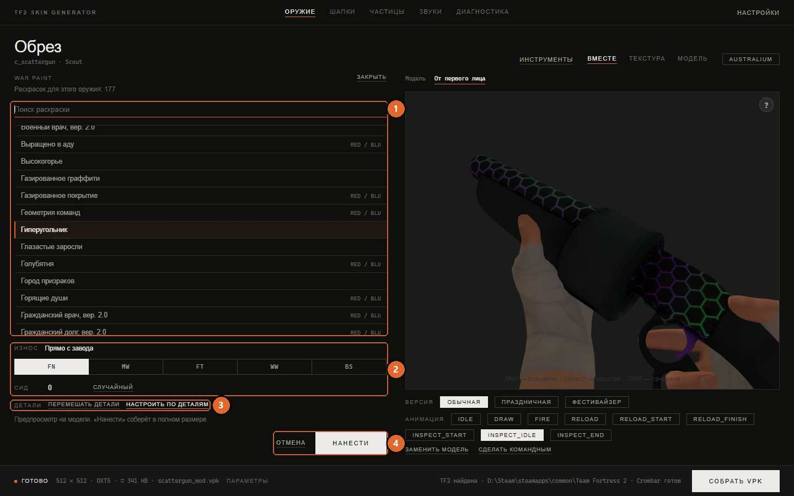

# War Paint

[Документация](../README.md) · [English version](../en/war-paint.md)

В TF2 War Paint устроен не как текстура, а как рецепт: игра берёт родную текстуру оружия и прямо во время игры накладывает на неё узоры, цвета, износ и наклейки. Приложение один раз выполняет такой же рецепт и запекает результат в обычную текстуру. Дальше она становится вашей заготовкой: её можно оставить как есть, дорисовать, разрезать на части или добавить эффекты и собрать как любой другой скин.

## Как открыть панель

Кнопка **War Paint** под альбомом появляется у оружия, которое класс держит в руках. У снарядов, аптечек и реквизита насмешек её нет.

Панель встаёт на место альбома, а модель справа остаётся на виду, так что любой выбор сразу видно на модели. Строка под заголовком подсказывает режим: **Раскрасок для этого оружия: N**, если у оружия есть War Paint в игре, или **Универсальный режим**, если нет (см. [ниже](#универсальный-режим)).

1. **Поиск раскраски** и список раскрасок для этого оружия.
2. **Износ** и **Сид**.
3. **Перемешать детали** и **Настроить по деталям**.
4. **Отмена** и **Нанести**.

**Закрыть** и **Отмена** выходят из панели без изменений и возвращают на модель настоящие текстуры.

## Выбор раскраски

Наберите название в **Поиске раскраски**, чтобы сузить список, и щёлкните по раскраске. Искать можно и по-русски, и по-английски: английское название стоит в строке серым рядом с русским, потому что в сообществе раскраски обычно зовут по-английски. Через мгновение соберётся быстрый предпросмотр 512 пикселей и ляжет на модель. Пока ничего не нанесено, поэтому список можно спокойно перебирать.

Некоторые раскраски помечены **RED / BLU**: узор у команд разный, и приложение собирает версию для той команды, которая активна сейчас.

Из строки поиска можно работать с клавиатуры: стрелки ходят по списку, <kbd>Enter</kbd> наносит выбранную раскраску, <kbd>Esc</kbd> закрывает панель. Двойной щелчок по раскраске тоже её наносит.

## Износ и сид

**Износ** повторяет пять игровых степеней: **FN** (Прямо с завода), **MW** (Немного поношенное), **FT** (После полевых испытаний), **WW** (Поношенное) и **BS** (Закалённое в боях). Полное название видно при наведении на кнопку. У некоторых раскрасок степеней меньше, и тогда предлагаются только они.

**Сид** задаёт, как узор ляжет на оружие: поворот, сдвиг и места износа. В игре он работает так же, и подходит любое целое число до 64 бит. **Случайный** выбирает новый сид. При смене износа или сида предпросмотр обновляется.

Приложение воспроизводит наложение раскраски шаг за шагом, как игра, поэтому результат очень близок к тому, что видно на оружии в игре. Точное совпадение по конкретному сиду в игре не проверялось, так что сид лучше воспринимать как способ найти понравившийся вид, а не как способ скопировать конкретный предмет.

## Материалы

Если у оружия несколько материалов, под сидом появляется ряд **Материалы**: по плитке с миниатюрой на каждый материал. Щелчок по плитке отмечает материал или снимает отметку. На отмеченной плитке сразу видно, как раскраска ляжет на этот материал, а снятая остаётся приглушённой. У каждого материала своя развёртка, поэтому раскраска собирается под каждый отмеченный материал отдельно, с теми же износом и сидом.

- У War Paint из игры сначала отмечены материалы, которые красит сама игра. Обычно это главный, у Детонатора ещё и гильза. Остальные можно отметить: узор ляжет на них по их деталям, как в [универсальном режиме](#универсальный-режим). На плитке это видно по пометке **в игре** или **по деталям**, а подпись под рядом напоминает, что игра такие материалы не красит. Раскраску, нарисованную под одно конкретное оружие, по другим материалам не разложить, и их плитки у неё неактивны.
- В универсальном режиме отмечены все материалы. Снимите отметку с того, что красить не нужно, например с линзы прицела или огонька запальника.

Материал части из [покраски по частям](model-parts.md) стоит в списке сразу за своим исходным материалом и получает ту же картинку, что и он: развёртка у них общая. Материалы без своей геометрии в модели в список не попадают.

Ручная раскладка узоров по деталям относится к главному материалу. Остальные материалы раскладываются автоматически.

## Нанесение

**Нанести** собирает раскраску в полном размере (1024 × 1024) и кладёт её на отмеченные материалы. С этого момента это обычная текстура на карточке: превью её показывает, поверх неё можно рисовать, а сборка приведёт её к разрешению из настроек сборки.

Раскраска ложится на карточки активной команды. Если у оружия отдельные текстуры для RED и BLU, переключитесь на другую команду и нанесите раскраску и там. Или оставьте BLU пустым и ответьте **Скопировать главную**, когда сборка про неё спросит.

Нанесение считается обычной правкой: <kbd>Ctrl</kbd>+<kbd>Z</kbd> его отменит, причём сразу на всех покрашенных материалах.

## Украшенное оружие

Ниже War Paint в списке идёт раздел **Украшенное оружие**. Это скины коллекций, которые выпадали из кейсов уже готовым оружием, начиная с обновления Gun Mettle: Шокирующая весть (Current Event), Ночной гуляка (Night Owl), Розовый слон (Pink Elephant) и другие, всего 84. В игре каждый такой скин есть только у своего оружия: Шокирующая весть, например, только у обреза. Подсказка у строки называет это оружие.

Рецепт такого скина нарисован под маски своей пушки: какой узор на какой её детали. Приложение раскладывает его по деталям вашей модели так же, как в [универсальном режиме](#универсальный-режим): разные виды узора (у Шокирующей вести это фиолетовые молнии, лавандовый и чёрный) достаются деталям примерно в тех же долях, что на оригинале. **Перемешать детали** и **Настроить по деталям** работают и здесь, а на экране раскладки плитки показывают сами виды узора. Получается вещь в стиле скина, а не точная копия: на оригинале узор по деталям раскладывали художники Valve.

У оружия, которому скин родной, он стоит в общем списке и собирается точно как в игре.

Три скина, Ястреб (Warhawk), Надувнорог (Balloonicorn) и Мистер Милашка (Mister Cuddles), нарисованы целиком под развёртку своей пушки одной картинкой, без деления на детали. На другом оружии от них остались бы обрывки в случайных местах, поэтому в этот раздел они не входят и остаются только у своих пушек. У Пчелы-убийцы (Killer Bee) поверх узора лежит такой же рисунок под развёртку обреза: на другом оружии он снимается, а полосы остаются.

## Универсальный режим

У большинства оружия War Paint в игре нет, как нет их и у модели, которую вы загрузили сами, и у модели из VPK-мода. Для них панель предлагает все War Paint, построенные на шаблоне узоров, в универсальном режиме. Об этом говорит пометка вверху панели.

Собственные War Paint оружия опираются на маски, которые художники Valve нарисовали под конкретную модель. В универсальном режиме приложение строит эти данные по вашей модели: группы берутся из частей модели (или из островов развёртки, если слоёв узора больше, чем частей), износ следует за расстоянием до краёв каждой части, а затенение берётся из самой текстуры. Наклейки не используются, потому что места под них на модели нет. Основой под узором служит игровая текстура оружия активной команды, а не ваши прошлые правки, поэтому War Paint никогда не ложится поверх другого War Paint.

Две кнопки в ряду **Детали** управляют тем, как раздаются узоры:

- **Перемешать детали** раздаёт узоры по-другому. Нажмите несколько раз, пока раскладка не понравится.
- **Настроить по деталям** открывает экран, где узор для каждой детали выбираете вы.

## Раскладка узоров по деталям

Экран раскладки доступен в универсальном режиме и у тех собственных War Paint оружия, которые разложены по группам. **К раскраскам** (или <kbd>Esc</kbd>) возвращает к списку.

Сверху стоят плитки узоров. Они работают и как кисть, и как цели для перетаскивания:

| Плитка | Что значит |
|---|---|
| **Основа** | Первая плитка большинства шаблонов: их первый узор, который лежит везде, где не выбран другой. |
| **Без узора** | Первая плитка шаблонов, которые рисуют поверх родной текстуры оружия. Оставляет текстуру оружия как есть. |
| **Узор 1**, **Узор 2**, ... | Остальные узоры шаблона. |

Под ними список деталей. У собственных War Paint оружия это группы, как их разметили художники Valve. В универсальном режиме это части модели, те же, что в [покраске по частям](model-parts.md).

Назначить узор можно тремя способами:

1. Выделить одну или несколько строк в списке и щёлкнуть по плитке узора.
2. Перетащить строки на плитку узора.
3. Щёлкнуть по плитке, чтобы взять её кистью, и щёлкать по деталям на 3D-модели.

В каждой строке видно, выбран её узор вручную или автоматом.

| Кнопка | Что делает |
|---|---|
| **Мелкие - в основу** | Отдаёт основе все детали меньше двух процентов текстуры. Это убирает пестроту на мелких деталях. |
| **Перемешать** | Раздаёт узоры случайно, следя за тем, чтобы крупные детали получили разные. |
| **Отменить** | Отменяет последнее изменение раскладки (<kbd>Ctrl</kbd>+<kbd>Z</kbd>). |
| **Сбросить** | Возвращает раскладку, которую сделал автомат. |
| **Разрезать деталь** | Открывает покраску по частям с ножницами, чтобы разделить слишком крупную деталь. Кнопка **Вернуться к War Paint** в кадре вернёт вас обратно, а новые детали уже будут в списке. |

Раскладка запоминается для этой раскраски на этом предмете и сохраняется вместе с работой.

Некоторые War Paint нарисованы под одно конкретное оружие, и раскладывать у них нечего. Для них ряд **Детали** не появляется.

## Ограничения

- **Сам рецепт изменить нельзя.** Рецепты War Paint хранятся в файле, который подписывает Valve, и с изменённым файлом игра не запустится. Поэтому приложение запекает раскраску в текстуру, а не правит её.
- **Игра сама не нанесёт War Paint на вашу модель.** В игре узоры следуют развёртке стоковой модели. Для своей геометрии приложение предлагает только универсальный режим, и в мод уходит запечённая текстура.
- **Настройки материала самого War Paint не переносятся.** Мод использует обычный материал оружия с запечённой текстурой, поэтому эффекты, которые в игре даёт материал раскраски, в него не попадают.

## См. также

- [Покраска по частям](model-parts.md): части, по которым универсальный режим раздаёт узоры.
- [Материалы и эффекты](materials.md): блеск или отражения поверх запечённой раскраски.
